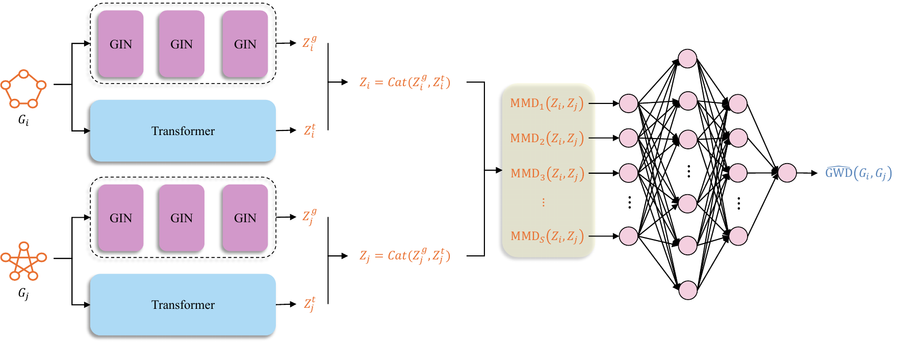
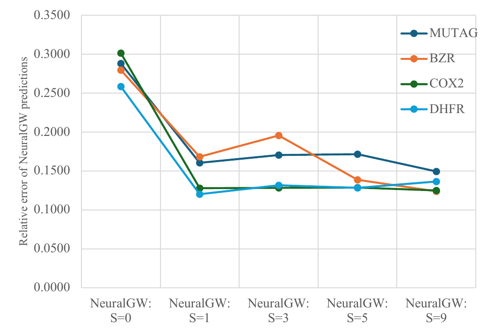
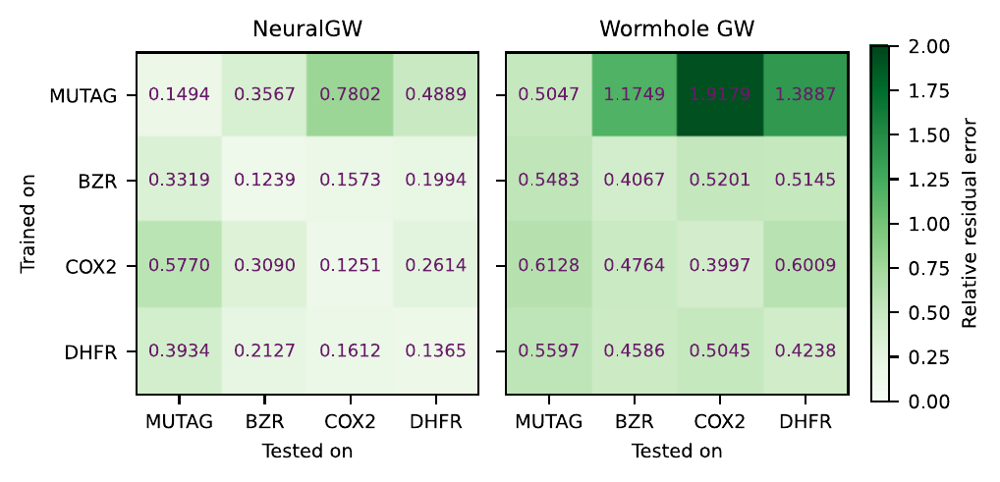
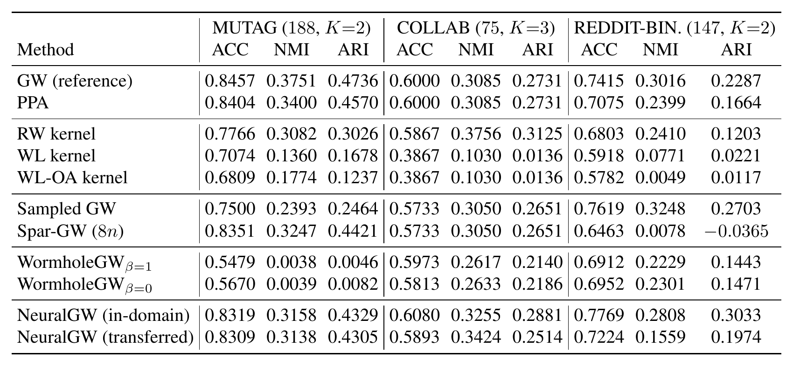
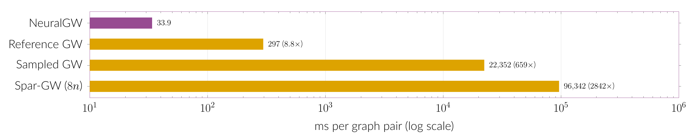

# NeuralGW <a href="https://neurips.cc/virtual/2026/loc/sydney/poster/151656"></a>

[](https://neurips.cc/virtual/2026/loc/sydney/poster/151656)

Code for **Bridging Graph Worlds: Neural Approximation of Gromov-Wasserstein Distances**
(Dong Qiao, Chris Ding, Jicong Fan; NeurIPS 2026).



NeuralGW predicts the Gromov-Wasserstein (GW) distance between two graphs. A shared GIN-Transformer
encoder with SVD positional encodings embeds the nodes of both graphs. A multi-kernel Maximum Mean
Discrepancy (MMD) layer compares the two sets of node embeddings, and a multilayer perceptron maps the
MMD values to the predicted distance. Once trained, it needs no iterative optimization at test time.

## Results

The numbers below are from the paper, which has the full experiments. Every error is a relative
error against the reference GW values; lower is better.

**In-domain prediction** (Table 2 of the paper; the best result per dataset is in bold).

| Method | MUTAG | BZR | COX2 | DHFR |
|---|---|---|---|---|
| Sampled GW | 0.4527 | 0.2916 | 0.4256 | 0.3223 |
| Spar-GW (8n) | 0.2259 | 0.3448 | 0.4927 | 0.3690 |
| Spar-GW (4n) | 0.5571 | 0.6771 | 0.8721 | 0.6849 |
| Spar-GW (2n) | 0.6895 | 0.6609 | 0.7924 | 0.6447 |
| WormholeGW (β=1) | 0.5416 ± 0.0194 | 0.5029 ± 0.0156 | 0.5908 ± 0.0304 | 0.4909 ± 0.0098 |
| WormholeGW (β=0) | 0.5046 ± 0.0171 | 0.4142 ± 0.0216 | 0.3997 ± 0.0098 | 0.4238 ± 0.0058 |
| NeuralGW-Naive | 0.2882 ± 0.0034 | 0.2796 ± 0.0102 | 0.3016 ± 0.0161 | 0.2587 ± 0.0079 |
| NeuralGW | **0.1494** ± 0.0343 | **0.1239** ± 0.0248 | **0.1251** ± 0.0046 | **0.1365** ± 0.0328 |

**Number of MMDs** (Figure 2 of the paper). More than a single MMD can help NeuralGW, although the
best number of MMDs depends on the dataset; S=0 is exactly the NeuralGW-Naive variant.

<p align="center"></p>

**Cross-domain prediction** (Figure 3 of the paper). Trained on one molecular dataset (row) and tested on
another (column): NeuralGW on the left, WormholeGW on the right.

<p align="center"></p>

**Graph clustering** (Table 4 of the paper; ACC, NMI and ARI, higher is better). Spectral clustering
from each distance matrix, with one bandwidth computed from the reference GW matrix and reused for every
method. MUTAG has 188 graphs in 2 clusters, the COLLAB subset 75 graphs in 3 and the REDDIT-BINARY subset
147 graphs in 2. RW, WL and WL-OA are the random walk, Weisfeiler-Lehman and WL optimal assignment
kernels. NeuralGW (transferred) is trained on PTC_FM+BZR, REDDIT-BINARY and COLLAB, respectively; the
WormholeGW and NeuralGW rows are means over five seeds. On COLLAB and REDDIT-BINARY, the clustering driven by NeuralGW
is close to that driven by the reference and slightly above it on ACC and ARI; on MUTAG, NeuralGW stays
slightly below the reference and behind Spar-GW at a high sampling rate.

<p align="center"></p>

**Runtime** (Table 5 of the paper, drawn as on the poster). Time per graph pair, with every method on the
same CPU, an Apple M1 Pro; the factor in parentheses is how much slower a method is than NeuralGW. The
pairs are REDDIT-BINARY graphs with 500–1000 nodes: NeuralGW was timed on all 666 test pairs, the
reference solver (POT's conditional gradient) on 5 of them and the sampling methods (ε = 0.01) on 3.
NeuralGW's time includes its SVD encoding; on an NVIDIA RTX 3090 GPU it takes 5.4 ms per pair.

<p align="center"></p>

## Setup

```bash
pip install -r requirements.txt
```

`requirements.txt` pins the versions the code was tested with (Python 3.12). Install the PyTorch and
PyTorch Geometric builds that match your CUDA version; without a GPU, the code runs on the CPU.
`grakel` (graph-kernel baselines) and `matplotlib` (plots) are needed only by the scripts that use them.

## Data and reference GW values

The datasets are TU datasets, which PyTorch Geometric downloads into `$NEURALGW_DATA_ROOT/TUDataset`
(default `./data`). The cross-domain and clustering runs on the 300–350-node subsets use a separate
root, `./data_300_350`, which their scripts set unless `NEURALGW_DATA_ROOT` is already set.

The reference GW distances are not stored in the repository. On first use,
`models/_utils_Processing.py` computes the missing ones and caches them under
`$NEURALGW_DATA_ROOT/precomputed/`. It uses POT's conditional-gradient solver
(`ot.gromov.gromov_wasserstein2` on the cost A + I, uniform marginals, `tol_rel = tol_abs = 1e-4`).
This takes seconds for MUTAG and hours for the larger REDDIT-BINARY subsets. `scripts/prep_collab_bal.py`,
`scripts/prep_bio_bal.py` and `scripts/prep_synth_gw.py` precompute the values for the clustering
subsets and the synthetic graphs. The values depend on the POT version, so pin POT when you need the
paper's exact reference values.

## Running

**In-domain:** train and test on one dataset (an 8:2 split of its graphs by default).

```bash
python main_indomain.py --ds_name MUTAG --seed 0
```

`python main_indomain.py --help` lists the other options: test ratio, positional encoding, cost
matrix and GPU.

**Cross-domain:** train on some datasets and test on another. `test.sh` wraps `main_cdomain.py` and
runs the job in the background. It logs to `logs_cdomain_test/` and saves the predicted distance
matrix of the test set to `results/clustering/{trainsets}_to_{testset}_seed{seed}_distance_matrix.npy`.

```bash
bash test.sh --trainsets PTC_FM BZR --testset MUTAG --seed 0 --cuda 0
```

`main_cdomain.py` treats its last `--ds_name*` argument as the test set; `test.sh` orders them for you.

**Experiment launchers:** `indomain/` and `cdomain/` hold the launchers for the experiment variants
(backbones, splits, transfer settings, large graphs). Run them from the repository root, for example
`bash indomain/main_indomain.sh`.

**Clustering:**

- `python scripts/spectral_cluster_cross_domain.py --trainsets PTC_FM BZR --testset MUTAG` runs spectral
  clustering on the cross-domain matrices in `results/clustering/` and reports ACC, NMI, ARI and RI,
  averaged over the seeds.
- `bash scripts/run_clustering_table.sh` queues the cross-domain runs for the clustering table.
  `bash scripts/run_cdomain_social.sh SRC TGT` trains on one dataset and predicts the distances on another.
- `scripts/run_indomain_target.py` trains in-domain and saves a target's full predicted matrix.
- `scripts/cluster_eval.py` scores distance matrices by spectral clustering, and
  `scripts/compute_kernels.py` computes the graph-kernel baselines with GraKeL.

## Configuration

`configs/main.json` holds the model and training defaults of the code used for the paper:
- 9 MMD kernels;
- learning rate 1e-4, batch size 4, no weight decay;
- up to 200 epochs, evaluating every 10 epochs and stopping after 3 evaluations without improvement.

The code also contains options added after the paper's experiments. They are all off by default and
were not used for its results:
- post-hoc calibration of the predictions (`NEURALGW_POSTHOC_CALIB`);
- positional-encoding normalization (`NEURALGW_PE_NORM`);
- adaptive MMD bandwidths (`NEURALGW_MMD_BW_ESTIMATOR`, `NEURALGW_MMD_BW_SCALE`);
- graph meta-features (`NEURALGW_META_INJECTION`);
- MLP-head variants (`head_use_layernorm` and `head_dropout_p` in the config, `NEURALGW_HEAD_OUTPUT_RELU`).

## Other tools

- `test_generating_large_graphs.py` generates random graphs with thousands of nodes and computes their
  GW distances (`--num_graphs`, `--n_min`, `--n_max`, `--avg_degree`, `--tol_rel`, `--tol_abs`,
  `--max_iter`).
- `test_generating_directed_graphs.py` builds directed variants of MUTAG and REDDIT-BINARY
  (`--source_name`, `--orientation`, `--tu_root`, `--verify`). To use them, pass `MUTAG_DIR` or
  `REDDIT-BINARY_DIR` as a dataset name.
- `check_triangle_inequality.py` counts the triangle-inequality violations in a saved distance matrix.
- `test_time.py` times the GW solver, its entropic and sampled variants, and NeuralGW's inference.
- `test_instability.py` compares GW values from different initializations on MUTAG.
- `plot_mmd_curve.py` plots MMD values across datasets and model configurations.

## Citation

```bibtex
@inproceedings{qiao2026bridging,
  title     = {Bridging Graph Worlds: Neural Approximation of {Gromov-Wasserstein} Distances},
  author    = {Qiao, Dong and Ding, Chris and Fan, Jicong},
  booktitle = {Advances in Neural Information Processing Systems},
  year      = {2026}
}
```

## License

MIT (see `LICENSE`).
